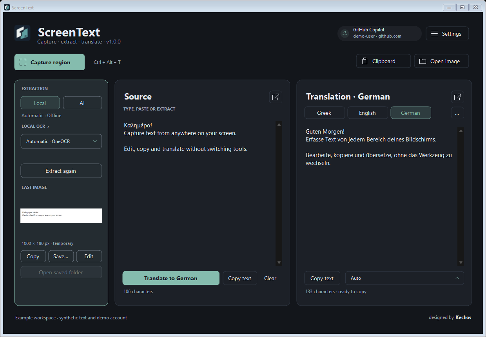

# ScreenText

Capture a region. Extract the text. Translate it without leaving your desktop.

ScreenText is a portable Windows application with local OCR, editable source and translation panes, and optional AI extraction and translation through a ChatGPT plan or GitHub Copilot account. No model API key is required.

**[Download for Windows x64](https://github.com/Kechos23/ScreenText/releases/latest)** · [Gitea releases](https://gitea.local.kechos.com/Kechos23/ScreenText/releases) · [Release notes](docs/releases/v1.0.0.md)



## Features

- Region capture with a configurable global shortcut; right-click or Esc cancels.
- Automatic local OCR using the installed Snipping Tool engine, with Windows OCR fallback.
- Mixed-language AI extraction and translation through the selected provider.
- Type or paste directly into Source; edit successful translations in either the workspace or expanded reading view.
- Separate extraction/translation model defaults and account-provided model catalogs.
- Quick target languages, searchable language selection and up to three favorites.
- Temporary screenshots by default; explicit Save and optional automatic storage.
- Preview, image copying and external editing with ShareX, Greenshot or a custom editor.
- Dark/light modes, six independent accent colors, startup-to-tray and close-to-tray options.

## Install and use

1. Download `ScreenText-1.0.0-win-x64.zip` from either release page and extract the entire folder.
2. Run `ScreenText.exe`. Keep the helper files and `copilot-runtime` folder beside it.
3. Capture a region with **Ctrl + Alt + T**, or use **Clipboard** / **Open image**. The shortcut can be changed in Settings.
4. Review the extracted text, choose a target language, then use **Translate to …** or **Ctrl + Enter** in Source.

The portable package includes private Node/Copilot runtimes; no global Node, Codex, ShareX or Copilot installation is needed. ScreenText itself is not code-signed. SHA-256 checksums are published alongside each release.

### Requirements

Windows 10/11 x64, .NET Framework 4.8 and Windows PowerShell 5.1. A compatible Microsoft Snipping Tool x64 package is needed for automatic OneOCR recognition. Windows OCR fallback needs installed language packs. Optional Copilot functionality follows the official CLI requirements, including PowerShell 7 on Windows. Internet and an eligible account/plan are needed for AI features.

## AI providers and accounts

Go to **Settings → AI Providers**, select a provider and connect. **Use for AI** explicitly chooses that provider for both online extraction and translation. Browsing settings does not switch providers or send AI requests. Local OCR works without either account.

| Provider | Connection | Usage and sign-out |
| --- | --- | --- |
| OpenAI / ChatGPT plan | Independent ScreenText browser sign-in; stored for the current Windows user | Uses the plan's shared Work/Codex allowance, not ordinary ChatGPT Chat. ScreenText sign-out affects its own connection. |
| GitHub Copilot | Official CLI browser sign-in, consumed by the official SDK | Uses Copilot plan allowance/policies. The CLI sign-in is shared on that Windows account; signing it out affects other tools relying on it. |

The header identifies the active provider and checked account. Copilot checks the expected host/login again before inference and blocks requests if another tool changes the account. Closing ScreenText keeps sign-in. Moving the app to a different PC does not transfer credentials.

Copilot supports `github.com` and Enterprise Cloud `*.ghe.com`; self-hosted Enterprise Server is not supported. Enterprise administrators must permit CLI usage. A working VS Code Copilot account alone does not establish CLI entitlement. Enterprise deployment still needs validation in your own managed environment.

Models are selected independently for extraction and translation. Catalog refresh preserves saved selections; absent models are marked **Unverified**. Copilot **Auto** may be the only permitted choice. Catalog listing does not guarantee quota, entitlement or image support. No automatic API-key or provider fallback is used.

## Privacy and storage

Screenshots stay temporary in memory unless you explicitly save them or enable automatic saving. New sessions start empty. Preferences are portable when the application folder is writable; otherwise they use `%LOCALAPPDATA%\ScreenText\Settings`. ChatGPT credentials are separately protected with Windows CurrentUser DPAPI. Copilot credentials remain managed by the official CLI.

Local OCR runs on your computer. AI actions send the source text or selected image to the active provider and follow that provider's policies. Copilot requests disable tools, configuration discovery, hooks, skills and memory; owned SDK sessions are cleaned after use and reclaimed after an interrupted run. Clipboard history/synchronization and external image editors have their own storage behavior.

See [architecture and limitations](docs/ARCHITECTURE.md) for implementation details. Automatic OneOCR is an **unofficial, undocumented integration** with installed Snipping Tool files; Windows updates can change compatibility. Microsoft models/DLLs are never distributed with ScreenText. The ChatGPT plan integration is experimental and may also change with service-side updates. This project is not affiliated with OpenAI, GitHub or Microsoft.

## Build and test

```powershell
.\build.ps1                       # Build and restore pinned private runtimes if missing
.\test.ps1                        # Fast offline checks
.\test.ps1 -Suite Connections     # Mock ChatGPT/Copilot; no real login or AI usage
.\test.ps1 -Suite All -Previews   # Full local regression; close tray app first
.\package.ps1                     # Versioned ZIP and SHA256SUMS.txt
.\run.ps1
```

Building requires Windows, the .NET Framework compiler, and Windows tar.exe for the first dependency restore. The build bootstraps a pinned private npm as well. Downloads are pinned and verified; no global packages are installed. Subsequent builds/tests reuse unchanged binaries and cached harnesses. `-SkipRuntime` builds local OCR/UI only. See [development and releases](docs/DEVELOPMENT.md).

## License

ScreenText's own code is [MIT licensed](LICENSE). Bundled dependencies remain under their respective licenses; see [third-party notices](THIRD-PARTY-NOTICES.md). GitHub Copilot CLI is redistributed unmodified as one component of ScreenText, under its own redistribution license.

Designed by **Kechos**.
